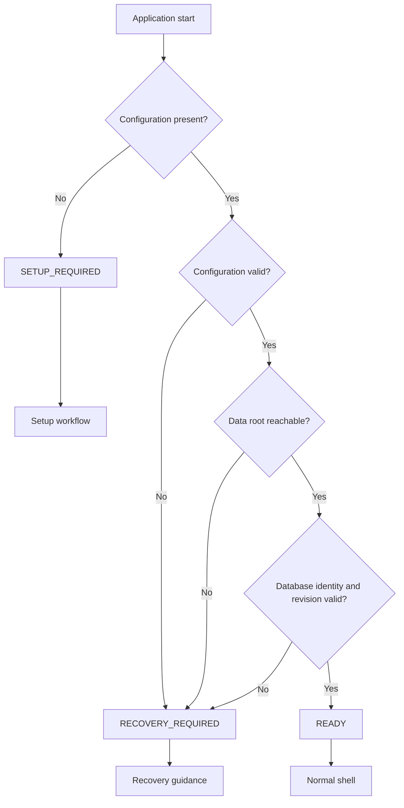
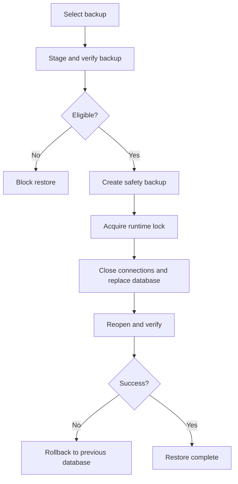
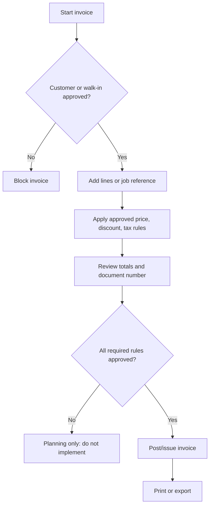
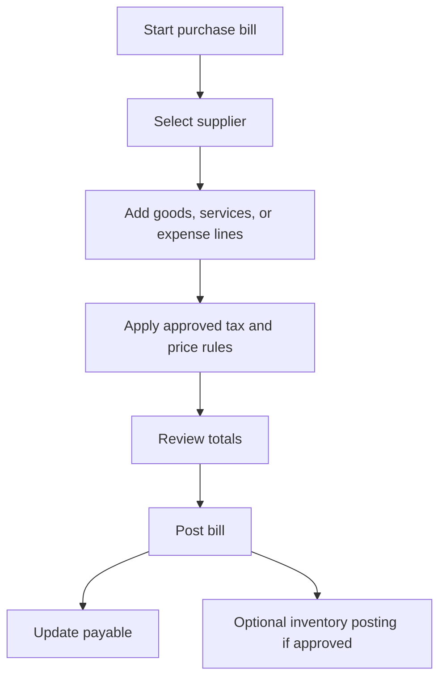

# BUSINESS WORKFLOWS — Gobindas Graphics Business Management System

| Field | Value |
| --- | --- |
| Document | BUSINESS_WORKFLOWS.md |
| Version | 1.0 |
| Date | 2026-11-18 |
| Status | Phase 6 planning output — proposed workflows require owner approval |
| Scope | Confirmed implemented system workflows and proposed business workflows |
| Related | BUSINESS_REQUIREMENTS.md, MODULE_SPECIFICATIONS.md, BUSINESS_RULES.md, REPORTING_REQUIREMENTS.md, OPEN_DECISIONS.md |

## 0. Status labels

- **[CONFIRMED]** — implemented or explicitly recorded in approved documentation.
- **[PROPOSED]** — planning-only workflow; not approved for implementation.
- **[REQUIRES OWNER CLARIFICATION]** — workflow cannot be reliably designed until decisions are made.
- **[OUT OF SCOPE]** — not included in the current product or current phase.
- Lifecycle names shown for proposed workflows are illustrative planning labels, not approved status codes.

## 1. Workflow inventory

| ID | Workflow | Classification | Notes |
| --- | --- | --- | --- |
| WF-C-01 | First-launch setup | [CONFIRMED] | Implemented in Phases 2–4. |
| WF-C-02 | Startup classification and recovery gate | [CONFIRMED] | `SETUP_REQUIRED`, `RECOVERY_REQUIRED`, `READY`. |
| WF-C-03 | Manual and scheduled backup | [CONFIRMED] | SQLite Online Backup API, verified before publish. |
| WF-C-04 | Restore with safety backup and rollback | [CONFIRMED] | Staged, lock-protected, reopen-verified. |
| WF-C-05 | Database relocation | [CONFIRMED] | Verified and atomic config update. |
| WF-C-06 | Pre-upgrade safety-backup gate | [CONFIRMED] | Required for maintenance migrations. |
| WF-P-01 | Business profile setup | [PROPOSED] | Depends on document profile field approval (`B6-09`). |
| WF-P-02 | Customer onboarding and maintenance | [PROPOSED] | Depends on customer field and balance decisions. |
| WF-P-03 | Supplier onboarding and maintenance | [PROPOSED] | Depends on supplier field and balance decisions. |
| WF-P-04 | Product/service catalogue maintenance | [PROPOSED] | Depends on Q-07 and `B6-01`. |
| WF-P-05 | Job intake / work-order handling | [REQUIRES OWNER CLARIFICATION] | Likely relevant to graphics work, but not confirmed (`B6-02`). |
| WF-P-06 | Quotation or estimate | [REQUIRES OWNER CLARIFICATION] | Provisional default is not in v1 (Q-13). |
| WF-P-07 | Sales invoice creation | [PROPOSED] | Tax, discount, numbering, and credit decisions are open. |
| WF-P-08 | Customer payment receipt | [PROPOSED] | Allocation and overpayment rules are open (Q-09). |
| WF-P-09 | Purchase bill recording | [PROPOSED] | Tax, returns, and payment rules are open. |
| WF-P-10 | Supplier payment recording | [PROPOSED] | Allocation rules are open. |
| WF-P-11 | Expense recording | [PROPOSED] | Categories, posting, and attachment rules are open. |
| WF-P-12 | Stock receipt, issue, and adjustment | [REQUIRES OWNER CLARIFICATION] | Only if inventory is in scope (Q-05, Q-06, `B6-07`). |
| WF-P-13 | Cancellation, void, return, or refund | [REQUIRES OWNER CLARIFICATION] | No rule is approved (Q-14). |
| WF-P-14 | Period-end review and reporting | [PROPOSED] | Depends on report and accounting decisions (Q-15, Q-17). |
| WF-P-15 | Attachment capture and retrieval | [REQUIRES OWNER CLARIFICATION] | Storage policy is open (Q-24). |
| WF-P-16 | Audit-history review | [PROPOSED] | Depends on audit actor, retention, and permissions (Q-04, Q-22). |

## 2. Confirmed implemented workflows

### WF-C-01 — First-launch setup

- **Status:** [CONFIRMED]
- **Purpose:** Create or adopt a valid local data root and application configuration without guessing paths or overwriting data.
- **Actors:** Local Windows user; Setup Wizard; `SetupService`; `ConfigManager`; `MigrationManager`; `StoragePaths`.
- **Start condition:** Application starts with no valid configuration and no recovery-blocking condition.
- **Required information:** Explicit data-root path chosen by the user; writable local folder; stable database identity.
- **Steps:**
  1. Collect and validate the data-root path.
  2. Refuse relative paths, UNC paths, and mapped network locations.
  3. Create only missing folders in the approved data-root layout.
  4. Create the SQLite database through `MigrationManager.create_database()`.
  5. Stamp and verify `0001_baseline`.
  6. Persist configuration atomically with `os.replace` and flush on Windows.
  7. Re-open the database and continue to `READY`.
- **Status transitions:** No configuration → `SETUP_REQUIRED` → configuration written → `READY`.
- **Validation/restrictions:** Path validation, access checks, safe folder creation, existing-database identity checks.
- **Failure/cancellation:** Invalid path, missing drive, access denied, corrupt config, invalid DB identity, or unsupported revision leads to blocking recovery or a failed setup result; no partial config is published.
- **Related workflows:** WF-C-02, WF-C-03, WF-C-05, WF-C-06.
- **Outputs/reports:** Valid config, valid local database, setup result surfaced in the wizard.
- **Business rules:** No business rules are executed; no business data is created.

### WF-C-02 — Startup classification and recovery gate

- **Status:** [CONFIRMED]
- **Purpose:** Prevent the application from silently starting against missing, invalid, unsafe, or unrecognized data.
- **Actors:** `AppContext`; `StartupClassifier`; `ConfigManager`; shell view model.
- **Start condition:** Every application launch.
- **Required information:** Configuration path, data-root path, database identity, current schema revision.
- **Steps:** Validate config presence and parseability; validate data-root reachability; validate database identity and revision; classify startup mode; allow only setup, recovery, or normal shell.
- **Status transitions:** `SETUP_REQUIRED` / `RECOVERY_REQUIRED` / `READY`.
- **Validation/restrictions:** Startup never creates a business database implicitly; normal startup never migrates; recovery remains blocking until resolved.
- **Failure/cancellation:** Any failed safety check selects `RECOVERY_REQUIRED` and blocks normal business UI use.
- **Related workflows:** WF-C-01, WF-C-04, WF-C-05, WF-C-06.
- **Outputs/reports:** Startup mode and honest user-facing status.
- **Business rules:** No business data workflow is available in setup or recovery mode.

### WF-C-03 — Manual and scheduled backup

- **Status:** [CONFIRMED]
- **Purpose:** Produce a restorable, verified backup without interrupting normal database use.
- **Actors:** Local user; Backup view; `BackupCoordinator`; `BackupService`; `BackupScheduler`; retention policy.
- **Start condition:** User requests a backup, a scheduled trigger fires, or a pre-upgrade gate requires one.
- **Required information:** Data-root layout, backup destination, backup kind, managed retention rules.
- **Steps:**
  1. Check source and destination safety.
  2. Create a temporary SQLite backup using the Online Backup API.
  3. Verify the temporary backup.
  4. Publish only after successful verification.
  5. Write sidecar metadata/history where applicable.
  6. Apply retention rules to managed automatic backups.
  7. Report success or a safe failure.
- **Status transitions:** Requested → Running → Verified/published or Failed.
- **Validation/restrictions:** No unmanaged destination overwrite; no unverified publish; no unsafe path assumptions.
- **Failure/cancellation:** Failed verification leaves the target unpublished and reports the error; existing backups are not silently destroyed.
- **Related workflows:** WF-C-02, WF-C-04, WF-C-05, WF-C-06.
- **Outputs/reports:** Verified backup artifact, backup history entry, task result status.
- **Business rules:** Backup metadata is technical metadata, not a business transaction report.

### WF-C-04 — Restore with safety backup and rollback

- **Status:** [CONFIRMED]
- **Purpose:** Restore a verified backup with strict safety controls and rollback.
- **Actors:** Local user; Backup view; `RestoreService`; `RuntimeCoordinator`; `AppContext`.
- **Start condition:** A backup file is selected and the application is in a safe state.
- **Required information:** Selected backup, current database path, data-root paths, identity and revision checks.
- **Steps:** Stage backup; verify eligibility; create safety backup; acquire runtime lock; close connections; replace database; reopen; verify identity and revision; publish success or rollback.
- **Status transitions:** Selected → Staged/verified → Safety-backed-up → Restoring → Verified complete or Rolled back.
- **Validation/restrictions:** Restore is lock-protected and refuses unverified, incompatible, or unsafe backups.
- **Failure/cancellation:** Any failed step triggers rollback where possible and reports the failure; no startup continues against an unverified restored database.
- **Related workflows:** WF-C-01, WF-C-02, WF-C-03, WF-C-05.
- **Outputs/reports:** Restore result, safety backup, backup history/result status.
- **Business rules:** Restoring replaces the local business dataset; no merge behavior exists.

### WF-C-05 — Database relocation

- **Status:** [CONFIRMED]
- **Purpose:** Move the data root to another valid local location without losing the database or leaving ambiguous config.
- **Actors:** Local user; Backup view; `RelocationService`; `ConfigManager`; `AppContext`.
- **Start condition:** User requests relocation and a valid destination is available.
- **Required information:** Current root, destination root, database and backup folder state.
- **Steps:** Validate destination; copy/move verified data; update config atomically; verify reopen; preserve old data root.
- **Status transitions:** Requested → Validating → Copying → Config updated → Verified complete or Failed.
- **Validation/restrictions:** No network location; no silent fallback; no destructive cleanup of the old root.
- **Failure/cancellation:** Failure leaves the old root usable and reports the failed destination.
- **Related workflows:** WF-C-01, WF-C-02, WF-C-03.
- **Outputs/reports:** Updated config and verified data at the destination.
- **Business rules:** Business data is copied as a unit; no record-level transformation occurs.

### WF-C-06 — Pre-upgrade safety-backup gate

- **Status:** [CONFIRMED]
- **Purpose:** Ensure a verified backup exists before any maintenance schema migration.
- **Actors:** Migration tooling; `MigrationManager`; backup service; maintenance operator.
- **Start condition:** A maintenance upgrade or schema migration is requested.
- **Required information:** Current revision, target revision, verified backup status.
- **Steps:** Check current revision; require verified safety backup; block upgrade if absent; run Alembic migration only after the gate passes.
- **Status transitions:** Upgrade requested → Backup gate passed → Migrated → Verified; or Upgrade blocked.
- **Validation/restrictions:** Normal GUI startup never migrates; only maintenance paths may migrate.
- **Failure/cancellation:** Missing/failed backup blocks migration; failed migration is handled by maintenance recovery and existing backups.
- **Related workflows:** WF-C-02, WF-C-03, WF-C-04.
- **Outputs/reports:** Migration result and safety-backup evidence.
- **Business rules:** No business rules are executed; this protects business data only.

## 3. Proposed business workflows

### WF-P-01 — Business profile setup

- **Status:** [PROPOSED]
- **Purpose:** Store the business identity and document defaults used on invoices, reports, and printed output.
- **Actors:** Owner/admin; Business Settings module.
- **Start condition:** Business data entry is being enabled after owner approval.
- **Required information:** Business name, address, contact details, tax identifiers if applicable, logo/attachment metadata, document footer text, default currency/fiscal conventions already confirmed.
- **Steps:** Enter profile → validate required fields → save → show profile status → allow document use once complete.
- **Proposed lifecycle:** Incomplete → Complete → Active → Archived/replaced.
- **Validation/restrictions:** Cannot issue documents requiring profile details while profile incomplete; fields are not approved.
- **Failure/cancellation:** Incomplete or invalid profile blocks saving or document issuance; prior valid profile remains visible.
- **Related workflows:** WF-P-06, WF-P-07, WF-P-09, WF-P-14.
- **Outputs/reports:** Business profile record and document header/footer data.
- **Open decisions:** `B6-09`, Q-03, Q-17.

### WF-P-02 — Customer onboarding and maintenance

- **Status:** [PROPOSED]
- **Purpose:** Maintain the parties to whom sales, jobs, and invoices relate.
- **Actors:** Operator; Owner/admin; Customer module.
- **Start condition:** New customer is identified or existing customer data needs correction.
- **Required information:** Customer identity, contact details, address, preferred contact method, opening balance policy if approved, status.
- **Steps:** Collect details → check duplicates → review → save → allow linking to jobs/invoices/payments.
- **Proposed lifecycle:** Active → Inactive; no hard delete after use.
- **Validation/restrictions:** Duplicate-resolution rules, required fields, and contact validation need approval.
- **Failure/cancellation:** Duplicate or invalid data blocks save; edits to referenced customers must preserve historical document snapshots.
- **Related workflows:** WF-P-05, WF-P-06, WF-P-07, WF-P-08, WF-P-14.
- **Outputs/reports:** Customer list, customer statement, outstanding balance report.
- **Open decisions:** `B6-13`, Q-08, Q-09, `B6-05`, `B6-11`.

### WF-P-03 — Supplier onboarding and maintenance

- **Status:** [PROPOSED]
- **Purpose:** Maintain the parties from whom purchases and services are obtained.
- **Actors:** Operator; Owner/admin; Supplier module.
- **Start condition:** New supplier is identified or supplier data changes.
- **Required information:** Supplier identity, contact details, address, payment/payable defaults if approved, status.
- **Steps:** Collect details → check duplicates → review → save → allow linking to purchases and payments.
- **Proposed lifecycle:** Active → Inactive; no hard delete after use.
- **Validation/restrictions:** Duplicate and required-field rules need approval.
- **Failure/cancellation:** Invalid or ambiguous supplier data blocks save; historical purchase snapshots remain intact.
- **Related workflows:** WF-P-09, WF-P-10, WF-P-14.
- **Outputs/reports:** Supplier list, supplier statement, outstanding payables report.
- **Open decisions:** `B6-13`, Q-09, `B6-11`.

### WF-P-04 — Product/service catalogue maintenance

- **Status:** [PROPOSED]
- **Purpose:** Maintain reusable catalogue items for services, goods, or both if approved.
- **Actors:** Owner/admin; Catalogue module.
- **Start condition:** A service/product is introduced, priced, retired, or corrected.
- **Required information:** Name/code, category, unit, active flag, price basis, default rate if approved, tax category if applicable.
- **Steps:** Define item → choose goods/service treatment → validate → save → use on documents.
- **Proposed lifecycle:** Draft → Active → Inactive.
- **Validation/restrictions:** Exact service catalogue, units, and price basis are unresolved (Q-07, `B6-01`).
- **Failure/cancellation:** Missing unit/price basis blocks save if required by later decision; referenced items are retired rather than deleted.
- **Related workflows:** WF-P-05, WF-P-06, WF-P-07, WF-P-09, WF-P-12, WF-P-14.
- **Outputs/reports:** Catalogue list, sales-by-item/service report, purchase-by-item report.
- **Open decisions:** Q-03, Q-05, Q-07, Q-23, `B6-01`.

### WF-P-05 — Job intake / work-order handling

- **Status:** [REQUIRES OWNER CLARIFICATION]
- **Purpose:** Track customer work from intake through completion if the business needs job-level control.
- **Actors:** Operator; designer/production user if applicable; Owner/admin.
- **Start condition:** A customer requests graphics/printing work.
- **Required information:** Customer, work description, item/service, quantity, due date, specifications, attachments, preliminary price if approved.
- **Steps (illustrative):** Register job → confirm scope → attach/reference artwork → track internal stages → complete → link to invoice/delivery.
- **Proposed lifecycle:** New → Confirmed → In progress → Ready for delivery → Invoiced → Closed; Cancelled as an exception.
- **Validation/restrictions:** No status, stage, required field, or approval rule is confirmed. Do not assume a production floor workflow.
- **Failure/cancellation:** Cancellation must preserve history and related documents once approved.
- **Related workflows:** WF-P-02, WF-P-04, WF-P-06, WF-P-07, WF-P-13, WF-P-15.
- **Outputs/reports:** Work list, due-date/workload reports, job-to-invoice trace.
- **Open decisions:** `B6-02`, `B6-03`, `B6-04`, Q-24.

### WF-P-06 — Quotation or estimate

- **Status:** [REQUIRES OWNER CLARIFICATION]
- **Purpose:** Present an estimated price before work begins, only if the business uses quotations.
- **Actors:** Owner/admin; Operator; Customer.
- **Start condition:** Customer requests a price before accepting work.
- **Required information:** Customer, job/scope, items/services, quantities, rates, discounts/tax if approved, validity period if approved.
- **Steps (illustrative):** Prepare estimate → review → send/print → accept/reject/expire → optionally convert to job or invoice.
- **Proposed lifecycle:** Draft → Sent → Accepted/Rejected/Expired → Converted.
- **Validation/restrictions:** Provisional project default is “not in v1” (Q-13). Do not implement without approval.
- **Failure/cancellation:** Withdrawn or rejected estimates remain audit records if the workflow is approved.
- **Related workflows:** WF-P-01, WF-P-02, WF-P-04, WF-P-05, WF-P-07.
- **Outputs/reports:** Quotation document, acceptance/conversion trace.
- **Open decisions:** Q-03, Q-08, Q-10, Q-13.

### WF-P-07 — Sales invoice creation

- **Status:** [PROPOSED]
- **Purpose:** Record a customer sale and produce a bill for goods/services/jobs.
- **Actors:** Operator; Owner/admin; Sales/Billing module; Customer and Catalogue modules.
- **Start condition:** Work is ready to bill or a direct sale occurs.
- **Required information:** Customer/walk-in policy, date, invoice number rule, lines, quantities, unit prices, discounts/tax if approved, payment terms if approved.
- **Steps:** Select customer → select job or lines → calculate → review → issue number → post → print/export → link to payment.
- **Proposed lifecycle:** Draft → Issued/Posted → Partially paid → Paid → Voided/Cancelled as exception.
- **Validation/restrictions:** Amounts use `Decimal` and integer paise; tax, discount, numbering, credit terms, and cancellation rules are unapproved.
- **Failure/cancellation:** Invalid lines, missing required fields, or unapproved rules block posting; posted invoices cannot be silently edited or deleted.
- **Related workflows:** WF-P-02, WF-P-04, WF-P-05, WF-P-08, WF-P-13, WF-P-14, WF-P-15.
- **Outputs/reports:** Invoice document, sales register, receivables, customer statement.
- **Open decisions:** Q-03, Q-08, Q-09, Q-10, Q-13, Q-14, Q-17, `B6-05`, `B6-08`, `B6-10`.

### WF-P-08 — Customer payment receipt

- **Status:** [PROPOSED]
- **Purpose:** Record money received from a customer and apply it correctly.
- **Actors:** Operator; Owner/admin; Payments/Receivables module.
- **Start condition:** Cash, bank transfer, UPI, cheque, or other approved payment method is received.
- **Required information:** Customer, amount, date, method, reference, target invoice/job if required, excess-payment handling if applicable.
- **Steps:** Record receipt → allocate to invoice/job/customer balance according to approved rule → review → post → update outstanding balance.
- **Proposed lifecycle:** Draft → Posted → Reconciled/Reversed as exception.
- **Validation/restrictions:** Allocation method, part-payment behavior, overpayment, and reversal rules are open (Q-09).
- **Failure/cancellation:** Unallocated or over-allocated receipts must not silently change balances; corrections require approved reversal/adjustment workflow.
- **Related workflows:** WF-P-02, WF-P-07, WF-P-13, WF-P-14.
- **Outputs/reports:** Payment receipt, customer statement, receivables/aging report.
- **Open decisions:** Q-09, Q-14, `B6-08`.

### WF-P-09 — Purchase bill recording

- **Status:** [PROPOSED]
- **Purpose:** Record amounts owed to suppliers for purchases or services.
- **Actors:** Operator; Owner/admin; Purchases module.
- **Start condition:** Supplier bill is received.
- **Required information:** Supplier, date, bill reference, lines, quantities, rates, tax if applicable, payable terms if approved.
- **Steps:** Select supplier → add lines → calculate → review → post → record payable → optionally post stock effect.
- **Proposed lifecycle:** Draft → Posted → Partially paid → Paid → Voided/Returned as exception.
- **Validation/restrictions:** Purchase order workflow, supplier bill numbering, tax, returns, and stock postings are unresolved.
- **Failure/cancellation:** Invalid or incomplete bills block posting; posted bills require an approved cancellation/return policy.
- **Related workflows:** WF-P-03, WF-P-04, WF-P-10, WF-P-11, WF-P-12, WF-P-13, WF-P-14.
- **Outputs/reports:** Purchase register, supplier statement, payables report.
- **Open decisions:** Q-03, Q-05, Q-06, Q-09, Q-10, Q-14, `B6-06`.

### WF-P-10 — Supplier payment recording

- **Status:** [PROPOSED]
- **Purpose:** Record money paid to a supplier and reduce the correct payable.
- **Actors:** Operator; Owner/admin; Payments/Payables module.
- **Start condition:** Supplier is paid by an approved method.
- **Required information:** Supplier, amount, date, method, reference, target bill if required.
- **Steps:** Record payment → allocate according to approved rule → post → update payable balance.
- **Proposed lifecycle:** Draft → Posted → Reconciled/Reversed as exception.
- **Validation/restrictions:** Allocation, part-payment, advance, and overpayment rules are unapproved.
- **Failure/cancellation:** Unresolved allocation blocks posting; reversals require approved audit behavior.
- **Related workflows:** WF-P-03, WF-P-09, WF-P-13, WF-P-14.
- **Outputs/reports:** Supplier statement, payables report, cash/bank summary.
- **Open decisions:** Q-09, Q-14.

### WF-P-11 — Expense recording

- **Status:** [PROPOSED]
- **Purpose:** Record business expenses that do not form part of a purchase bill.
- **Actors:** Operator; Owner/admin; Expenses module.
- **Start condition:** Business cost is paid or incurred.
- **Required information:** Date, category, payee, amount, payment method, reference, notes, optional attachment metadata.
- **Steps:** Enter expense → validate → categorize → post → include in expense/report totals.
- **Proposed lifecycle:** Draft → Posted → Voided/Corrected as exception.
- **Validation/restrictions:** Categories, payment methods, tax treatment, approval thresholds, and attachment rules are unapproved.
- **Failure/cancellation:** Invalid or unapproved expenses block posting; posted expenses cannot be silently deleted.
- **Related workflows:** WF-P-01, WF-P-09, WF-P-14, WF-P-15, WF-P-16.
- **Outputs/reports:** Expense register, expense-by-category, profit and loss if approved.
- **Open decisions:** Q-03, Q-15, Q-24, `B6-10`.

### WF-P-12 — Stock receipt, issue, and adjustment

- **Status:** [REQUIRES OWNER CLARIFICATION]
- **Purpose:** Track inventory or consumables only if the business confirms stock is held.
- **Actors:** Storekeeper/operator; Owner/admin; Inventory module.
- **Start condition:** Goods are received, used, returned, counted, or adjusted.
- **Required information:** Item, location if applicable, quantity, unit, date, source document, valuation rule if approved.
- **Steps (illustrative):** Record movement → validate availability → post movement → update stock balance → include in valuation reports.
- **Proposed lifecycle:** Movement Draft → Posted → Reversed as exception.
- **Validation/restrictions:** Valuation method, negative-stock behavior, opening stock, and adjustment approval are unresolved (Q-05, Q-06).
- **Failure/cancellation:** Negative stock or unapproved valuation must not be silently allowed; reversal behavior needs approval.
- **Related workflows:** WF-P-04, WF-P-07, WF-P-09, WF-P-13, WF-P-14.
- **Outputs/reports:** Stock ledger, stock summary, movement register, valuation report if approved.
- **Open decisions:** Q-05, Q-06, Q-16, `B6-07`.

### WF-P-13 — Cancellation, void, return, or refund

- **Status:** [REQUIRES OWNER CLARIFICATION]
- **Purpose:** Correct posted business documents while preserving financial history.
- **Actors:** Owner/admin; optionally accountant/reviewer; relevant transaction modules.
- **Start condition:** A posted invoice, bill, payment, expense, or stock movement must be corrected.
- **Required information:** Original document, reason, date, amount, approval, replacement/credit behavior if applicable.
- **Steps (illustrative):** Request correction → approve if required → create reversal/credit/void record → update balances → preserve audit trail.
- **Proposed lifecycle:** Correction requested → Approved/Rejected → Reversal posted → Original marked void/returned.
- **Validation/restrictions:** No cancellation, credit note, refund, negative stock, or reversal rule is approved (Q-14).
- **Failure/cancellation:** Unapproved corrections must remain blocked; hard-deleting posted documents is prohibited.
- **Related workflows:** WF-P-07, WF-P-08, WF-P-09, WF-P-10, WF-P-11, WF-P-12.
- **Outputs/reports:** Void/reversal register, adjusted balances, audit history.
- **Open decisions:** Q-04, Q-14, Q-22, `B6-10`, `B6-11`.

### WF-P-14 — Period-end review and reporting

- **Status:** [PROPOSED]
- **Purpose:** Review business activity for a day, month, fiscal year, or custom range.
- **Actors:** Owner/admin; accountant/reviewer if approved; Reporting module.
- **Start condition:** User requests an operational or financial report.
- **Required information:** Report type, date range, fiscal year context, filters, grouping, export format.
- **Steps:** Choose report → choose filters → preview → validate totals against source documents → print/PDF/Excel export if approved.
- **Proposed lifecycle:** Filter set → Preview → Exported/Printed.
- **Validation/restrictions:** Report definitions cannot be finalized until tax, accounting depth, valuation, and revenue-recognition decisions are made.
- **Failure/cancellation:** Missing permissions or unresolved report rules block generation; exported files must not overwrite existing files silently.
- **Related workflows:** All proposed business workflows.
- **Outputs/reports:** Operational and financial reports defined in `REPORTING_REQUIREMENTS.md`.
- **Open decisions:** Q-04, Q-15, Q-17, `B6-12`.

### WF-P-15 — Attachment capture and retrieval

- **Status:** [REQUIRES OWNER CLARIFICATION]
- **Purpose:** Link receipts, artwork, proofs, and other files to business records if attachments are in scope.
- **Actors:** Operator; Owner/admin; Attachment service.
- **Start condition:** A document image or supporting file needs to be retained.
- **Required information:** File, related entity, category, description, hash/size metadata, storage policy.
- **Steps (illustrative):** Select file → validate type/size → store according to policy → link metadata → retrieve/preview.
- **Proposed lifecycle:** Uploading → Linked → Replaced/Removed as exception.
- **Validation/restrictions:** Storage location, max size, allowed types, hashing, backup inclusion, and removal rules are unapproved (Q-24).
- **Failure/cancellation:** Invalid file or failed storage leaves no broken link; existing file remains unchanged.
- **Related workflows:** WF-P-01, WF-P-05, WF-P-07, WF-P-09, WF-P-11.
- **Outputs/reports:** Attachment metadata and retrieval list.
- **Open decisions:** Q-18, Q-24, AQ-04.

### WF-P-16 — Audit-history review

- **Status:** [PROPOSED]
- **Purpose:** Review who/what changed financially significant records, if audit visibility is approved.
- **Actors:** Owner/admin; reviewer role if approved; Audit service.
- **Start condition:** User opens history for a record or investigates a change.
- **Required information:** Entity type/id, event list, actor identity, timestamp, correlation ID, before/after summary.
- **Steps:** Select record → query append-only audit events → filter → display → export if approved.
- **Proposed lifecycle:** Events are append-only; corrections create new events.
- **Validation/restrictions:** Actor model depends on Q-04; retention and visibility depend on Q-22.
- **Failure/cancellation:** Missing audit data must be reported honestly, not reconstructed.
- **Related workflows:** All proposed business workflows.
- **Outputs/reports:** Record history and audit export if approved.
- **Open decisions:** Q-04, Q-22, `B6-11`.

## 4. Cross-cutting workflow rules

- [CONFIRMED] All workflows must remain local/offline; no workflow may require network access.
- [CONFIRMED] Application services own workflow orchestration; UI only collects intent and displays results.
- [CONFIRMED] Domain rules must be framework-independent and testable without PySide6.
- [CONFIRMED] Money calculations use `Decimal`; persistence uses integer minor units.
- [CONFIRMED] Destructive technical operations require verification and rollback where applicable.
- [PROPOSED] Posted business records should never be hard-deleted; corrections should be explicit, audited records.
- [PROPOSED] Long-running actions should use the existing task-runner/feedback pattern rather than freezing the UI.
- [PROPOSED] Status labels, permissions, and approvals require owner approval before implementation.

## 5. Implementation sequencing guidance

Recommended dependency order after owner review:

1. Business profile, customers, suppliers, product/service catalogue.
2. Job/work-order handling if confirmed.
3. Invoicing and customer payments.
4. Purchases and supplier payments.
5. Expenses.
6. Inventory only if confirmed.
7. Reports and exports.
8. Access control and audit visibility if confirmed.

This is a [PROPOSED] sequence, not a commitment to implement all modules.
