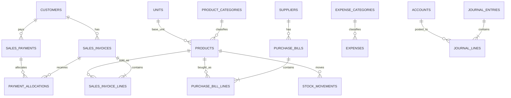

# DATABASE_SCHEMA — Gobindas Graphics Business Management System

| Field | Value |
| --- | --- |
| Document | DATABASE_SCHEMA.md |
| Version | 1.6 |
| Date | 2026-11-20; Phase 7B-1 audit retention corrected 2026-11-21; Phase 8B authentication added 2026-11-23 |
| Status | Phase 7B profile/version/audit tables and Phase 8B authentication tables implemented; all other business tables remain proposed |
| Related | BLUEPRINT.md, ARCHITECTURE.md, BACKUP_STRATEGY.md |
| Schema baseline | `0001_baseline`, `0002_business_profile`, `0003_business_profile_requirements`, and implemented `0004_authentication` |

> **Important:** The implemented profile slice now comprises `business_profile`, `business_profile_versions`, and `audit_events`. Phase 2 created only Alembic's `alembic_version` table plus the SQLite file-identity PRAGMAs; Phase 7A added `business_profile`; Phase 7B corrects it with migration `0003_business_profile_requirements`; Phase 8B adds the `roles`, `users`, and `login_throttles` authentication tables in migration `0004_authentication`. Every other business table in this document is **proposed**. Tables for unconfirmed workflows are marked **[PROVISIONAL]** and must not be created during initialization.

## Phase 7B implemented schema correction (authoritative)

Migration `0003_business_profile_requirements` adds `secondary_phone`, `logo_reference`, and `version_number` to `business_profile`, creates `business_profile_versions` and `audit_events`, adds immutability triggers, and backfills the existing active profile with version 1 and one audit event without changing its values. The application head is now `0004_authentication`; the Phase 7B head was `0003_business_profile_requirements`.

`logo_reference` stores a safe relative reference under `Logos/`, never an absolute path. Version rows retain mandatory/optional field values and the effective logo reference. The implemented `audit_events` table stores `id`, `event_type`, `entity_type`, `entity_id`, `actor`, `created_at`, and `payload`. It has no foreign keys, no expiry or retention column, and no cascade path. Audit rows use actor `system/unauthenticated`, are retained indefinitely under the owner-approved Phase 7B-1 policy, and have no ordinary UI.

Append-only behavior is enforced at three layers: `AuditEventRepository` exposes only `add()`/`list()`; immutable ORM records are rejected on update/delete before flush; and `BEFORE UPDATE`/`BEFORE DELETE` SQLite triggers abort direct SQL changes. There is no automatic audit cleanup, scheduled purge, or retention-based row deletion. Verified restore checks audit structure and appends any audit events written after the selected backup before replacing the live file, so history is neither omitted nor renumbered. `MigrationManager.downgrade()` refuses any downgrade that would drop the audit table while audit rows exist. Backup sidecars use optional `managed_assets` entries for logo bytes with size and SHA-256 verification. Historical Phase 7A statements saying no history, logo path, or audit table existed are superseded for this slice.

## Phase 8B implemented authentication schema (authoritative)

Migration `0004_authentication` adds three tables and changes no existing table, Business Profile record, or historical audit row:

| Table | Columns | Constraints and purpose |
| --- | --- | --- |
| `roles` | `key TEXT PK`, `display_name TEXT NOT NULL` | Four reference rows only: `owner_admin`, `operator`, `accountant_reviewer`, `viewer`. No role is added at runtime and no user is seeded. |
| `users` | `id INTEGER PK`, `username`, `username_key`, `email`, `password_hash`, `is_active`, `role_key FK → roles.key`, `created_at`, `updated_at` | `username_key` is unique for case-insensitive identity; `is_active` is a 0/1 check; `role_key` is constrained to the four approved keys; indexes cover role and active status. `password_hash` stores only a self-describing Argon2id or scrypt PHC-style value. |
| `login_throttles` | `username_key TEXT PK`, `failed_count`, `first_failed_at`, `cooldown_until` | Persists generic failed-login state across restarts; a non-negative count and optional ISO-8601 cooldown timestamp enforce the five-attempt/15-minute policy. |

There is deliberately **no `user_roles` table**: each `users` row has one `role_key`. There is no session table — the session is memory-only and nothing about authentication is stored in `QSettings`. A downgrade from `0004_authentication` is refused when user accounts or audit rows exist, protecting both local identities and append-only history.

## 1. Design principles

1. **Exactness over convenience.** Money, prices, rates, and quantities are stored as scaled integers. No `REAL`, no float, no SQLite `NUMERIC` reliance.
2. **Short transactions.** One use case writes one transaction; no UI or file IO inside it.
3. **Referential integrity on.** SQLite foreign keys are enabled per connection and enforced by constraints.
4. **History is preserved.** Posted financial documents are never hard-deleted; they are voided with an audit trail.
5. **Constraints in the database.** Uniqueness, non-negativity, and status/date checks are enforced by the schema, not only by Python.
6. **Indexes follow queries.** Add indexes for known filters; avoid speculative indexes.
7. **Migrations only.** Alembic is the sole mechanism for schema change; no runtime `CREATE TABLE` outside migrations except SQLite internals.
8. **One database per business.** No tenant/company column in v1.

## 2. Naming and type conventions

| Item | Convention |
| --- | --- |
| Tables | `snake_case`, plural (`sales_invoices`) |
| Columns | `snake_case`, singular (`invoice_date`) |
| Primary key | `id INTEGER PRIMARY KEY` (SQLite rowid alias) |
| Public identifier | `public_id TEXT NOT NULL UNIQUE` (UUIDv4) on externally referenced aggregates |
| Foreign key | `<entity>_id`, e.g., `customer_id` |
| Money columns | suffix `_minor` (integer minor units) |
| Unit price columns | suffix `_e4` (integer × 10,000) |
| Quantity columns | suffix `_e3` (integer × 1,000) |
| Rate/percent columns | suffix `_e6` (integer × 1,000,000) |
| Booleans | `INTEGER NOT NULL DEFAULT 0 CHECK (col IN (0,1))` |
| Dates | `TEXT` ISO-8601 `YYYY-MM-DD` (business date, no timezone) |
| Timestamps | `TEXT` ISO-8601 UTC `YYYY-MM-DDTHH:MM:SS.ffffffZ` |
| Enum-like values | `TEXT` + `CHECK (col IN (...))` or lookup table |
| JSON | `TEXT` containing valid JSON; use only for audit/extension payloads |
| Constraint naming | `pk_`, `fk_`, `uq_`, `ck_`, `ix_` prefixes (SQLAlchemy naming convention) |

SQLAlchemy 2 declarative mappings must set an explicit naming convention so Alembic can generate deterministic constraint names.

## 3. Identity strategy

- **Internal PK:** integer, compact, efficient for joins and indexes.
- **Public ID:** UUIDv4 text for invoices, customers, exports, and support references; never expose sequential IDs in exported filenames if avoidable.
- **Document numbers:** human-facing, generated inside the same transaction from `document_sequences`; unique per document type and fiscal year.
- **Line numbers:** sequential within the parent document, unique with the parent.
- IDs are generated in the application, not by triggers, so tests and imports are deterministic.

## 4. Money, quantity, and rounding policy

### 4.1 Storage scales

| Concept | Column suffix | Scale | Example stored | Displayed |
| --- | --- | --- | --- | --- |
| Currency amount | `_minor` | 2 | `12345` | 123.45 |
| Unit price | `_e4` | 4 | `123456` | 12.3456 |
| Quantity | `_e3` | 3 | `123456` | 123.456 |
| Percentage/rate | `_e6` | 6 | `50000` | 5.0000% (0.05) |
| Exchange rate (if ever) | `_e8` | 8 | — | not in v1 |

**Currency minor unit:** default 2 decimals (INR paise). If a currency with a different minor unit is ever supported, each currency row must carry `minor_unit` and the schema must store it; the v1 code does not hard-code 2 outside the `Currency` value object.

### 4.2 Value objects

```python
@dataclass(frozen=True)
class Money:
    minor: int
    currency: str  # ISO 4217, e.g. "INR"


@dataclass(frozen=True)
class Quantity:
    milli: int


@dataclass(frozen=True)
class UnitPrice:
    e4: int


@dataclass(frozen=True)
class Rate:
    e6: int  # 0..1 represented as millionths; 5% = 50_000
```

Rules:

- Value objects reject floats at construction (`TypeError`).
- Arithmetic returns exact `Decimal` intermediates and explicit rounded results.
- A `Money` and a different currency cannot be added.
- Negative amounts are allowed only where the domain says so (credit notes, adjustments); document lines store positive quantities and amounts.
- Formatting (thousands separators, symbol placement) belongs to the UI, not the database.

### 4.3 Rounding

- Policy: **ROUND_HALF_UP** for currency amounts, unless the owner chooses another policy.
- Round **once** at each defined boundary; store the rounded result.
- Never recompute a stored total from unrounded intermediates.
- Line amount:

```text
line_gross_minor = round_half_up(quantity_e3 * unit_price_e4 / 100_000)
line_discount_minor = round_half_up(line_gross_minor * discount_rate_e6 / 1_000_000)
line_net_minor = line_gross_minor - line_discount_minor
line_tax_minor = round_half_up(line_net_minor * tax_rate_e6 / 1_000_000)
line_total_minor = line_net_minor + line_tax_minor
```

- Document totals are sums of stored line values, plus an explicit `rounding_minor` field if cash rounding is later enabled.
- Worked example: 123.456 sq ft × 12.3456 = 1,524.1383936 → stored line gross `152414` minor (1,524.14).
- Discounts and tax allocation across lines: largest-remainder method when an invoice-level amount must be distributed; document the algorithm in code and tests.
- Negative values round symmetrically (half away from zero) via `Decimal` `ROUND_HALF_UP`.

### 4.4 Conversion boundaries

- UI input → `Decimal` → value object → integer for persistence.
- Database integer → value object → `Decimal` for calculation → integer/display string.
- CSV/Excel import parses with an explicit locale and rejects ambiguous formats.
- PDF/Excel export formats from stored values; it never re-does financial math.

### 4.5 Prohibited

- `float` anywhere in `app/domain`, application financial services, or ORM money columns.
- SQLite `REAL` for money, price, rate, quantity, or tax.
- `ROUND_HALF_EVEN` unless the owner explicitly chooses it for a specific calculation.
- Storing formatted strings such as `"1,234.56"` as the source of truth.

## 5. Date and time policy

- Business dates (invoice date, expense date) are local calendar dates stored as `TEXT YYYY-MM-DD`. They are not converted between time zones.
- Audit timestamps are UTC, stored with an explicit `Z` suffix at the application boundary.
- The application uses an injected `Clock` abstraction so tests are deterministic.
- The business time zone is a setting (default from Windows, proposed `Asia/Kolkata` for West Bengal, India) and is used only for display and scheduling.
- Fiscal year start is a business setting: **1 April** (Indian fiscal year, April–March), confirmed by the owner (Q-11).

## 6. Proposed entity map

### 6.1 Platform and configuration

| Table | Purpose | Status |
| --- | --- | --- |
| `app_settings` | Key/value internal settings that must travel with the DB | Proposed |
| `business_profile` | Single-row business identity; implemented in Phase 7A | Implemented |
| `document_sequences` | Next number per document type/fiscal year | Proposed |
| `audit_logs` | Append-only record of significant actions | Proposed |
| `attachments` | Metadata for files stored under `Attachments\` | Proposed |
| `backup_runs` | Backup history mirrored for UI; sidecar metadata remains authoritative if DB is lost | Proposed |
| `users` | Local login identities; one approved `role_key` per account | Implemented in Phase 8B |
| `roles` | Four approved role reference rows | Implemented in Phase 8B |
| `login_throttles` | Persistent failed-login/cooldown state | Implemented in Phase 8B |
| `user_roles` | User/role assignment | Not used — one role per `users.role_key` |

### 6.2 Master data

| Table | Purpose | Status |
| --- | --- | --- |
| `parties` | Customer/Supplier basic master records (shared table, `party_kind`) | Implemented in Phase 9 (2026-11-23) |
| `customers` | Customer records and credit terms (future transaction-facing extension) | Proposed; Phase 9 uses `parties` for basic master slice |
| `suppliers` | Supplier records (future transaction-facing extension) | Proposed; Phase 9 uses `parties` for basic master slice |
| `product_categories` | Hierarchical categories | Proposed |
| `units` | Unit of measure and decimal precision | Proposed |
| `products` | Goods/services, pricing, tax defaults | Proposed |
| `product_units` | Product-specific unit conversions | Proposed |

### 6.3 Sales

| Table | Purpose | Status |
| --- | --- | --- |
| `sales_invoices` | Invoice header | Proposed |
| `sales_invoice_lines` | Invoice lines | Proposed |
| `sales_payments` | Customer receipts | Proposed |
| `payment_allocations` | Receipt → invoice allocation | Proposed |
| `sales_returns` / `sales_return_lines` | Returns/credit notes | **PROVISIONAL — Q-14** |
| `quotations` / `quotation_lines` | Quotations | **PROVISIONAL — Q-13** |

### 6.4 Purchases

| Table | Purpose | Status |
| --- | --- | --- |
| `purchase_bills` | Supplier bill header | Proposed |
| `purchase_bill_lines` | Bill lines | Proposed |
| `supplier_payments` | Payments to suppliers | Proposed |
| `supplier_payment_allocations` | Payment → bill allocation | **PROVISIONAL** |
| `purchase_returns` / `purchase_return_lines` | Purchase returns | **PROVISIONAL — Q-14** |

### 6.5 Inventory

| Table | Purpose | Status |
| --- | --- | --- |
| `stock_movements` | Append-only signed stock ledger | Proposed |
| `stock_adjustments` / `stock_adjustment_lines` | Manual corrections | **PROVISIONAL** |
| `stock_balances` | Optional cached balance per product | Proposed (optional) |

### 6.6 Expenses and accounting

| Table | Purpose | Status |
| --- | --- | --- |
| `expense_categories` | Expense classification | Proposed |
| `expense_accounts` | Link categories to ledger accounts | **PROVISIONAL** |
| `expenses` | Expense records | Proposed |
| `accounts` | Chart of accounts | **PROVISIONAL — Q-15** |
| `journal_entries` | Accounting entry header | **PROVISIONAL — Q-15** |
| `journal_lines` | Debit/credit lines | **PROVISIONAL — Q-15** |
| `fiscal_periods` | Open/closed periods | **PROVISIONAL** |
| `bank_accounts` | Bank/cash account details | **PROVISIONAL** |

### 6.7 Reporting

Reports are queries/views, not stored tables, except optional saved-report definitions (not planned for v1).

## 7. Proposed table details

These are design sketches, not DDL. Column lists will be finalized per module with the owner. All tables include `created_at`, `updated_at`, and `created_by` where meaningful unless noted.

### 7.1 `business_profile` (proposed design sketch, superseded by §19)

| Column | Type | Constraints |
| --- | --- | --- |
| `id` | INTEGER | PK, CHECK (id = 1) |
| `legal_name` | TEXT | NOT NULL |
| `display_name` | TEXT | NOT NULL |
| `address` | TEXT | NULL |
| `phone` | TEXT | NULL |
| `email` | TEXT | NULL |
| `tax_id` | TEXT | NULL |
| `currency_code` | TEXT(3) | NOT NULL, default `INR` (Q-01) |
| `fiscal_year_start_month` | INTEGER | NOT NULL, 1..12, default 4 (Q-11: April–March) |
| `timezone` | TEXT | NOT NULL, default `Asia/Kolkata` (West Bengal, India) |
| `logo_path` | TEXT | NULL (relative to Attachments) |

A single-row constraint is enforced with `CHECK (id = 1)` plus service-level validation.

### 7.2 `document_sequences`

| Column | Type | Constraints |
| --- | --- | --- |
| `id` | INTEGER | PK |
| `document_type` | TEXT | NOT NULL (`invoice`, `purchase`, `receipt`, `expense`, …) |
| `fiscal_year` | INTEGER | NOT NULL |
| `prefix` | TEXT | NOT NULL |
| `next_number` | INTEGER | NOT NULL, CHECK > 0 |
| `padding` | INTEGER | NOT NULL, default 6 |

- `UNIQUE (document_type, fiscal_year)`.
- Number allocation happens inside the same transaction as document creation with an `UPDATE ... RETURNING` (SQLite 3.35+) or a `SELECT` followed by a conditional update; concurrency is single-writer, but the sequence must still be atomic.

### 7.3 `audit_logs`

| Column | Type | Notes |
| --- | --- | --- |
| `id` | INTEGER | PK |
| `occurred_at` | TEXT | UTC timestamp |
| `actor_user_id` | INTEGER | FK `users.id`, NULL for system actions |
| `action` | TEXT | e.g., `invoice.create`, `payment.void`, `backup.restore` |
| `entity_type` | TEXT | e.g., `sales_invoice` |
| `entity_id` | TEXT | Public ID or integer as text |
| `correlation_id` | TEXT | Ties to diagnostic logs |
| `summary` | TEXT | Human-readable, no secrets |
| `details_json` | TEXT | Redacted before/after summary, JSON |

- Append-only: no UPDATE/DELETE from application code.
- Indexes: `(occurred_at)`, `(entity_type, entity_id)`, `(actor_user_id, occurred_at)`.
- Retention: indefinite (owner-approved in Phase 7B-1). Audit visibility resolved under Q-22 (2026-11-22): Owner/Admin-only view and audited export; all significant business, security, and admin events recorded; existing historical rows unchanged.

### 7.4 `parties` (implemented, Phase 9 Customer & Supplier Management)

Phase 9 implements a shared basic master table for customers and suppliers. Financial fields (opening balance, credit limit, tax, ledger) are intentionally out of scope.

| Column | Type | Constraints |
| --- | --- | --- |
| `id` | INTEGER | PK AUTOINCREMENT |
| `party_kind` | TEXT | NOT NULL, CHECK IN (`customer`,`supplier`) |
| `name` | TEXT | NOT NULL, trimmed non-empty |
| `name_key` | TEXT | NOT NULL, normalized case-insensitive name key |
| `phone` | TEXT | NOT NULL DEFAULT `''` |
| `email` | TEXT | NOT NULL DEFAULT `''` |
| `address` | TEXT | NOT NULL DEFAULT `''` |
| `contact_person` | TEXT | NOT NULL DEFAULT `''` |
| `notes` | TEXT | NOT NULL DEFAULT `''` |
| `is_active` | BOOLEAN/INTEGER | NOT NULL DEFAULT 1, CHECK IN (0,1) |
| `created_at` | TEXT | NOT NULL, ISO-8601 UTC |
| `updated_at` | TEXT | NOT NULL, ISO-8601 UTC |

- Indexes: `(party_kind, name_key)`, `(party_kind, phone)`, `(party_kind, is_active)`.
- Duplicate policy (owner-approved 2026-11-23): warn on case-insensitive normalized name match; also warn on matching phone for existing active record when phone provided; save allowed only after explicit confirmation.
- Lifecycle: activate/deactivate supported; hard delete not exposed in normal UI; referenced records must never be unsafely deleted.
- Audit: append-only `audit_events` rows with `entity_type='party'` and event types `party.created`, `party.updated`, `party.activated`, `party.deactivated`.

### 7.4a `customers` (proposed future transaction shape; suppliers mirror)

| Column | Type | Constraints |
| --- | --- | --- |
| `id` | INTEGER | PK |
| `public_id` | TEXT | NOT NULL, UNIQUE |
| `code` | TEXT | NOT NULL, UNIQUE |
| `name` | TEXT | NOT NULL |
| `contact_person` | TEXT | NULL |
| `phone` | TEXT | NULL |
| `email` | TEXT | NULL |
| `address` | TEXT | NULL |
| `credit_limit_minor` | INTEGER | NOT NULL DEFAULT 0, CHECK >= 0 |
| `opening_balance_minor` | INTEGER | NOT NULL DEFAULT 0 (method TBD with accounting) |
| `opening_balance_date` | TEXT | NULL |
| `is_active` | INTEGER | NOT NULL DEFAULT 1 |
| `notes` | TEXT | NULL |

- Indexes: `(name)`, `(phone)`, `(is_active)`.
- `code` generation rule is **[OPEN]** (manual vs automatic).
- Balances are derived from invoices/payments/opening entries, not stored, unless performance later requires a cache.
- Future transaction modules must reconcile this proposed shape with the implemented `parties` table before implementation.

### 7.5 `products`

| Column | Type | Constraints |
| --- | --- | --- |
| `id` | INTEGER | PK |
| `public_id` | TEXT | NOT NULL, UNIQUE |
| `sku` | TEXT | UNIQUE, NULL allowed for services |
| `name` | TEXT | NOT NULL |
| `category_id` | INTEGER | FK `product_categories.id`, NULL |
| `product_type` | TEXT | NOT NULL, CHECK IN (`goods`,`service`) |
| `base_unit_id` | INTEGER | FK `units.id`, NOT NULL |
| `sale_price_e4` | INTEGER | NOT NULL DEFAULT 0, CHECK >= 0 |
| `purchase_price_e4` | INTEGER | NOT NULL DEFAULT 0, CHECK >= 0 |
| `tax_rate_e6` | INTEGER | NULL, CHECK 0..1,000,000 |
| `track_inventory` | INTEGER | NOT NULL DEFAULT 1; must be 0 for `service` |
| `reorder_level_e3` | INTEGER | NOT NULL DEFAULT 0, CHECK >= 0 |
| `is_active` | INTEGER | NOT NULL DEFAULT 1 |

- Indexes: `(name)`, `(category_id)`, `(is_active)`, `(sku)`.
- Unit conversion: `product_units(product_id, unit_id, factor_e6)` with `UNIQUE (product_id, unit_id)` and exactly one base unit per product. Whether conversions are needed is Q-07.

### 7.6 `sales_invoices`

| Column | Type | Constraints |
| --- | --- | --- |
| `id` | INTEGER | PK |
| `public_id` | TEXT | NOT NULL, UNIQUE |
| `number` | TEXT | NOT NULL, UNIQUE |
| `customer_id` | INTEGER | FK `customers.id`, NULL for walk-in |
| `invoice_date` | TEXT | NOT NULL |
| `due_date` | TEXT | NULL, CHECK >= invoice_date |
| `status` | TEXT | NOT NULL, CHECK IN (`draft`,`issued`,`void`) |
| `subtotal_minor` | INTEGER | NOT NULL, CHECK >= 0 |
| `discount_minor` | INTEGER | NOT NULL DEFAULT 0, CHECK >= 0 |
| `tax_minor` | INTEGER | NOT NULL DEFAULT 0, CHECK >= 0 |
| `total_minor` | INTEGER | NOT NULL, CHECK >= 0 |
| `paid_minor` | INTEGER | NOT NULL DEFAULT 0, CHECK >= 0 |
| `rounding_minor` | INTEGER | NOT NULL DEFAULT 0 |
| `notes` | TEXT | NULL |
| `voided_at` | TEXT | NULL; required when status = `void` |
| `void_reason` | TEXT | NULL |

- CHECK: `voided_at IS NULL` when status ≠ `void`.
- CHECK: `total_minor = subtotal_minor - discount_minor + tax_minor + rounding_minor` (if no invoice-level discount; exact formula finalized with Q-08).
- Indexes: `(invoice_date)`, `(customer_id, invoice_date)`, `(status)`, `(due_date)`.
- Partially paid status is derived from `paid_minor` vs `total_minor`; do not store a redundant payment status unless measured need.
- `paid_minor` is maintained transactionally with allocations; a reconciliation query must detect drift.

### 7.7 `sales_invoice_lines`

| Column | Type | Constraints |
| --- | --- | --- |
| `id` | INTEGER | PK |
| `invoice_id` | INTEGER | NOT NULL, FK `sales_invoices.id` ON DELETE RESTRICT |
| `line_no` | INTEGER | NOT NULL, CHECK > 0 |
| `product_id` | INTEGER | FK `products.id`, NULL for free-text service line |
| `description` | TEXT | NOT NULL |
| `quantity_e3` | INTEGER | NOT NULL, CHECK > 0 |
| `unit_id` | INTEGER | FK `units.id`, NOT NULL |
| `unit_price_e4` | INTEGER | NOT NULL, CHECK >= 0 |
| `discount_rate_e6` | INTEGER | NOT NULL DEFAULT 0, CHECK 0..1,000,000 |
| `discount_minor` | INTEGER | NOT NULL DEFAULT 0, CHECK >= 0 |
| `tax_rate_e6` | INTEGER | NOT NULL DEFAULT 0, CHECK 0..1,000,000 |
| `tax_minor` | INTEGER | NOT NULL DEFAULT 0, CHECK >= 0 |
| `line_total_minor` | INTEGER | NOT NULL, CHECK >= 0 |

- `UNIQUE (invoice_id, line_no)`.
- Index `(product_id)` for product sales history.
- All line amounts are stored, not recomputed on read.

### 7.8 `stock_movements`

| Column | Type | Constraints |
| --- | --- | --- |
| `id` | INTEGER | PK |
| `public_id` | TEXT | NOT NULL, UNIQUE |
| `product_id` | INTEGER | NOT NULL, FK `products.id` |
| `movement_date` | TEXT | NOT NULL |
| `movement_type` | TEXT | NOT NULL, CHECK IN (`opening`,`purchase`,`sale`,`adjustment`,`sales_return`,`purchase_return`,`transfer`) |
| `quantity_e3` | INTEGER | NOT NULL, CHECK != 0; positive = in, negative = out |
| `unit_cost_e4` | INTEGER | NULL, CHECK >= 0 |
| `source_type` | TEXT | NULL (e.g., `sales_invoice`) |
| `source_id` | INTEGER | NULL |
| `notes` | TEXT | NULL |

- Indexes: `(product_id, movement_date)`, `(source_type, source_id)`, `(movement_date)`.
- Append-only; corrections are compensating movements, never edits.
- Valuation method is Q-05; `unit_cost_e4` semantics depend on it.

### 7.9 `expenses`

| Column | Type | Constraints |
| --- | --- | --- |
| `id` | INTEGER | PK |
| `public_id` | TEXT | NOT NULL, UNIQUE |
| `number` | TEXT | NOT NULL, UNIQUE |
| `category_id` | INTEGER | FK `expense_categories.id`, NOT NULL |
| `expense_date` | TEXT | NOT NULL |
| `payee` | TEXT | NULL |
| `amount_minor` | INTEGER | NOT NULL, CHECK > 0 |
| `tax_minor` | INTEGER | NOT NULL DEFAULT 0, CHECK >= 0 |
| `payment_method` | TEXT | NOT NULL, CHECK IN (`cash`,`bank`,`mobile`,`credit`) |
| `reference` | TEXT | NULL |
| `notes` | TEXT | NULL |
| `attachment_id` | INTEGER | FK `attachments.id`, NULL |
| `status` | TEXT | NOT NULL, CHECK IN (`draft`,`posted`,`void`) |

- Index `(expense_date)`, `(category_id, expense_date)`.

### 7.10 `attachments`

| Column | Type | Constraints |
| --- | --- | --- |
| `id` | INTEGER | PK |
| `public_id` | TEXT | NOT NULL, UNIQUE |
| `entity_type` | TEXT | NOT NULL |
| `entity_id` | INTEGER | NOT NULL |
| `file_name` | TEXT | NOT NULL |
| `relative_path` | TEXT | NOT NULL, UNIQUE |
| `mime_type` | TEXT | NOT NULL |
| `size_bytes` | INTEGER | NOT NULL, CHECK > 0 |
| `sha256` | TEXT(64) | NOT NULL |
| `created_at` | TEXT | NOT NULL |

- Files are stored under `Attachments\<entity_type>\<public_id>\<filename>`; the database never stores absolute paths.
- Deleting is logical; orphan cleanup is an explicit maintenance action.

### 7.11 Accounting (provisional)

`journal_entries` header: `id`, `public_id`, `number`, `entry_date`, `description`, `source_type`, `source_id`, `status` (`posted`,`void`), `created_by`, `created_at`.
`journal_lines`: `id`, `entry_id`, `account_id`, `debit_minor`, `credit_minor`, `memo`; CHECK (`debit_minor >= 0 AND credit_minor >= 0 AND (debit_minor = 0) != (credit_minor = 0)`).
`accounts`: `id`, `code` unique, `name`, `account_type` (`asset`,`liability`,`equity`,`income`,`expense`), `parent_id`, `is_system`, `is_active`.

- Balance rule: sum(debit) = sum(credit) per entry, enforced in the service and verified by a test/report.
- Posted entries are immutable; corrections are reversing entries.

## 8. Relationships (proposed)



Cardinality notes:

- A sales invoice has one or more lines; lines cannot exist without a header.
- A payment can allocate to multiple invoices; an invoice can receive multiple payments.
- Stock movements are independent ledger rows referencing a source document; they are not cascade-deleted.
- Deleting a master referenced by history is blocked by `ON DELETE RESTRICT`; deactivate instead.

## 9. Constraints and indexes

### 9.1 Global rules

- Foreign keys `ON DELETE RESTRICT` by default; `ON UPDATE RESTRICT`.
- Child lines use `ON DELETE CASCADE` only for drafts that have never been posted; posted documents are voided.
- Unique document numbers are enforced in the database, not only generated in Python.
- Monetary checks: totals non-negative where the domain requires; line quantities positive; rates within 0..1.
- Status checks use `CHECK` with explicit allowed values.
- Dates: `due_date >= invoice_date`, `expense_date` valid calendar date checked in the application.
- No nullable boolean flags; use NOT NULL with a default.

### 9.2 Index strategy

| Query pattern | Index |
| --- | --- |
| Invoice list by date | `sales_invoices(invoice_date)` |
| Customer statement | `sales_invoices(customer_id, invoice_date)` |
| Unpaid invoices | `sales_invoices(status, due_date)` — add partial index if measurements justify |
| Product sales history | `sales_invoice_lines(product_id)` |
| Stock ledger | `stock_movements(product_id, movement_date)` |
| Document → movements | `stock_movements(source_type, source_id)` |
| Party search | `customers(name)`, `customers(phone)` |
| Audit lookup | `audit_logs(entity_type, entity_id)`, `audit_logs(occurred_at)` |
| Expense reports | `expenses(expense_date)`, `expenses(category_id, expense_date)` |

Rules:

- Verify with `EXPLAIN QUERY PLAN` before adding an index.
- Avoid indexing low-selectivity flags alone; combine with a date or party column.
- Partial indexes are allowed (SQLite supports them) when a query targets one status.

## 10. SQLite-specific considerations

### 10.1 Connection settings

Applied on every connection (see ADR-008):

```sql
PRAGMA foreign_keys = ON;
PRAGMA busy_timeout = 5000;
PRAGMA journal_mode = WAL;          -- persistent database property, set once
PRAGMA synchronous = FULL;          -- durability for financial writes
PRAGMA wal_autocheckpoint = 1000;   -- pages
PRAGMA temp_store = MEMORY;
PRAGMA trusted_schema = OFF;        -- if compatible with bundled SQLite
```

- `journal_mode=WAL` is persistent; verify it after opening (an external copy may not have it).
- `foreign_keys` is per connection and must be enabled via a SQLAlchemy `connect` event.
- Do not use `PRAGMA locking_mode=EXCLUSIVE`; it defeats WAL readers and backups.
- Phase 2 implements this profile in `app/infrastructure/database/engine.py` for every
  connection, verifies that WAL and foreign-key enforcement are actually active, and
  exposes the busy timeout as `DatabaseConfig.busy_timeout_ms` (default 5000).

### 10.2 WAL files and backup

- While the app runs, `-wal` and `-shm` files exist. Copying only the `.db` file can lose recent commits.
- All backups use the Online Backup API (BACKUP_STRATEGY.md), never a raw file copy.
- On clean shutdown, run a passive checkpoint; do not block shutdown indefinitely.
- Phase 2 performs a best-effort `PRAGMA wal_checkpoint(PASSIVE)` before disposing
  the engine. The sidecar files disappear after a clean checkpoint when no other
  connection is using them; this does not make them backups.

### 10.3 Type affinity

- Use `INTEGER` for IDs, scaled integers, and booleans.
- Use `TEXT` for dates, timestamps, enums, and public IDs.
- Avoid `NUMERIC`/`DECIMAL` columns; SQLite may store them as REAL.
- Add `CHECK (typeof(col) = 'integer')` only where it adds real safety and does not complicate migrations.

### 10.4 Alembic with SQLite

- Enable `render_as_batch=True` in `env.py`; SQLite cannot drop/alter columns directly.
- Keep migrations small and test batch operations.
- Never edit the `alembic_version` table manually.
- Store migration scripts inside the app bundle; resolve their path relative to the executable in frozen builds.
- Test upgrade from the previous release on a copy of a real database.
- If a migration cannot be done safely in place, create a new table, copy, verify counts, drop, and rename inside one transaction.

### 10.5 Database file properties

- Set `PRAGMA application_id` to a project-specific constant and `PRAGMA user_version` to an app schema marker (optional, useful for diagnostics).
- Phase 2 values: `application_id = 1195525971` (`0x47424753`, ASCII `GBGS`) and
  `user_version = 1`. They are written by `0001_baseline`, not by runtime code.
  Alembic's revision remains the authority; `user_version` is diagnostic only.
  A file with a different non-zero `application_id` is refused.
- Page size: leave SQLite default unless a measured reason exists; changing it requires `VACUUM`.
- `auto_vacuum`: leave off by default; run `VACUUM` as a maintenance action with free-space checks, never automatically inside a user action.

## 11. Migration strategy

| Topic | Decision |
| --- | --- |
| Tool | Alembic, programmatic configuration |
| Location | `migrations/versions/` |
| Baseline | `0001_baseline` creates no application tables; only identity PRAGMAs, with Alembic's `alembic_version` table; business tables added per approved module |
| Runtime | On startup, compare DB revision to head; Phase 2 refuses pending migrations because the safety backup arrives in Phase 4 |
| Maintenance | `python -m app.tools.migrate {init,upgrade,downgrade,status,history,check}` with an explicit absolute path |
| Downgrade | Not automatic; restore from safety backup on failure |
| Data migrations | Separate, tested, idempotent where possible |
| Naming | `NNNN_short_description.py` with a stable revision identifier |
| Review | Every migration reviewed for data loss and lock time |
| Frozen app | Scripts bundled; path resolved from the app or `GOBINDAS_MIGRATIONS_DIR`, never the current working directory |

Migration sequence:

1. Open DB read-only and read `alembic_version` plus `application_id`.
2. If DB revision > app head: refuse to start (newer app needed). Do not downgrade.
3. If DB revision < app head: create verified safety backup → run `alembic upgrade head` → verify schema and `integrity_check`.
4. On any failure: restore the safety backup, log, and show a blocking error.
5. Record the app version and schema revision in logs and backup metadata.

Phase 2 implements steps 1–2 and refuses step 3 until Phase 4 supplies the
verified safety backup. The CLI performs explicit upgrades against temporary or
operator-selected files; it never upgrades the configured database on its own.

A database is created only by the first-launch setup wizard or `migrate init`
(or a test fixture). The parent folder must already exist, and an existing file
is never overwritten. Setup calls `MigrationManager.create_database()` and then
verifies identity, revision, and health; it does not use
`Base.metadata.create_all()` and does not insert a revision manually.

## 12. Data integrity verification

- `PRAGMA quick_check` on startup (bounded), full `integrity_check` after migrations and before accepting a backup.
- Phase 2 startup performs identity and revision checks only. It does not scan the
  whole file on every launch; `DatabaseDiagnostics.check(full=True)` and
  `python -m app.tools.migrate ... check --full` are explicit maintenance actions.
- Phase 2 health diagnostics also verify read/write capability by taking a
  `BEGIN IMMEDIATE` lock and immediately rolling it back, without modifying a
  table or row.
- Reconciliation queries (run in tests and optionally a maintenance screen):
  - invoice `paid_minor` equals the sum of allocations;
  - stock balance equals the sum of movements;
  - journal entry debits equal credits;
  - document sequence is ahead of the maximum used number.
- Foreign key check: `PRAGMA foreign_key_check` after restore and migrations.
- Orphan checks for attachments and lines.

## 13. Performance and growth

- Target database size < 2 GB; set a soft warning at 1.5 GB in settings.
- Archive/void old documents rather than deleting them.
- Reports use SQL aggregation and date-bounded queries.
- Avoid loading full line history for list screens; use summary projections.
- If list offsets become slow beyond ~100k rows, introduce keyset pagination rather than adding indexes blindly.
- Measure before denormalizing. `stock_balances` and `customer_balances` caches are allowed only with a documented rebuild/verification command.

## 14. Backup metadata

Two layers:

1. **In-database `backup_runs`** for UI history while the current DB is healthy.
2. **Sidecar `.meta.json`** next to each backup for recovery when the DB is lost. Contains: backup filename, mode, created_at, app version, schema revision, source DB size, sha256, integrity result, duration, operator (Windows user), and app instance ID.

The sidecar is written last, after the backup file is verified and renamed. A backup without a valid sidecar is still restorable but flagged "unverified metadata".

## 15. Proposed versus confirmed

| Area | Confirmed | Proposed |
| --- | --- | --- |
| SQLite + SQLAlchemy 2 + Alembic | Yes | — |
| Exact money storage | Integer minor units required by no-float rule | Scale 2; exact suffix conventions |
| FK enforcement | Required | `ON DELETE RESTRICT` defaults |
| WAL | Evaluate per brief | Enable WAL + `synchronous=FULL` |
| Tables and columns | — | All business tables |
| Fiscal year start | 1 April (April–March, Indian fiscal year) | — |
| Tax, valuation, numbering | — | Defaults pending Q-03/Q-05/Q-10 |
| Auth tables | — | Conditional on Q-04 |

## 16. Open schema questions

| ID | Question | Affects |
| --- | --- | --- |
| Q-01 | Currency minor units — resolved: INR, 2 decimals | All money columns, formatting |
| Q-02 | Multi-currency | Totals, payments, accounts |
| Q-03 | Tax model | Line/header tax columns |
| Q-04 | Users and roles | Auth tables, audit actor |
| Q-05 | Inventory valuation | `unit_cost_e4`, COGS, stock value |
| Q-06 | Negative stock | Sales validation, stock checks |
| Q-07 | Units/conversions | `product_units`, pricing by area |
| Q-08 | Discounts/rounding | Line/header discount fields |
| Q-10 | Numbering | `document_sequences`, unique constraints |
| Q-11 | Fiscal year — resolved: 1 April (April–March) | Sequences, periods, reports |
| Q-12 | Branches/warehouses | Stock tables |
| Q-13/Q-14 | Orders/returns | Additional document tables |
| Q-15 | Accounting depth | Journal tables |
| Q-22 | Audit retention | Audit indexes and pruning |

## 17. Phase 2 implementation status (2026-11-13)

### 17.1 Tables actually created

| Table | Origin | Purpose | Justification |
| --- | --- | --- | --- |
| `alembic_version` | Alembic | Stores the current revision (`version_num`) | Required by the approved migration tool; do not edit manually |

No application table exists at the baseline. In particular:

- No `schema_metadata` table: Alembic already stores the authoritative revision,
  and `PRAGMA user_version` is a cheap diagnostic marker.
- No `app_settings` table: machine configuration remains in
  `%APPDATA%\GobindasBMS\config.json` per ADR-009. Duplicating it would create two
  sources of truth.
- No `business_profile` table: business identity fields are not approved yet.
- No `audit_logs` table: the event model, retention policy, and privacy rules are
  not approved; a speculative audit system would be misleading.

There are no Phase 2 relationships or business indexes. The only constraints and
indexes are those Alembic creates for `alembic_version`.

### 17.2 Money storage

- INR is the default currency: code `INR`, symbol `₹`, 2 decimal places,
  100 paise per rupee.
- Phase 2 adds `app/domain/value_objects/money.py` with `Decimal`-in and
  signed 64-bit integer-paise persistence.
- `decimal_to_minor` performs one explicit `ROUND_HALF_UP`; the exact variant
  rejects unsupported precision; `minor_to_decimal` returns an exact `Decimal`.
- Binary `float` and `bool` are rejected at the boundary; out-of-range amounts
  raise `MoneyRangeError`.
- Future money columns must store integer paise in `INTEGER` columns and never use
  `REAL` or SQLite `NUMERIC`/`DECIMAL` affinity.

### 17.3 Migration and backup consequences

- `migrations/env.py` uses programmatic configuration with `render_as_batch=True`.
- `0001_baseline` is reversible: downgrade resets `application_id` and
  `user_version` to 0 and removes the revision row.
- Startup refuses to modify any schema until Phase 4 can create a verified safety
  backup first.
- The database remains a single SQLite file with WAL sidecars while open. Backups
  must use the SQLite Online Backup API and include WAL content; copying `.db`,
  `.db-wal`, or `.db-shm` separately is not a valid backup.
- Phase 2 verification: fresh init, status, explicit upgrade, history, downgrade,
  full integrity checks, foreign-key violation rejection, and transaction
  rollback were all exercised against temporary databases.

## 18. Phase 3 initialization status (2026-11-14)

### 18.1 Schema unchanged

Phase 3 adds **no table, column, index, constraint, or migration revision**.
The database created at first launch is exactly the Phase 2 baseline:

| Item | Value |
| --- | --- |
| Application tables | None |
| Alembic table | `alembic_version` with `0001_baseline` |
| `PRAGMA application_id` | `1195525971` (`0x47424753`, "GBGS") |
| `PRAGMA user_version` | `1` |

No `business_profile`, `app_settings`, `schema_metadata`, `audit_logs`, or other
speculative table is created. Business-profile fields remain unapproved and are
an open decision for a later phase.

### 18.2 Initialization path

1. The setup wizard validates the selected data root and creates only the
   documented folders.
2. `DataRootLayout` supplies the fixed database file name
   `Database/BusinessManagement.db` under the selected root.
3. `SetupService` constructs an absolute `DatabaseConfig` and calls
   `MigrationManager.create_database()`.
4. The manager applies `0001_baseline`, which sets the identity PRAGMAs and
   records the Alembic revision.
5. `DatabaseDiagnostics.check(full=True)` verifies the file, identity, revision,
   SQLite integrity, foreign keys, and read/write capability.
6. Only after verification is `data_root` and `database_path` persisted in
   `%APPDATA%\GobindasBMS\config.json`.

### 18.3 Existing-file policy

- An existing healthy Gobindas database at the expected revision is adopted
  without modification.
- An unknown `application_id`, corrupt file, uninitialized schema, older schema,
  or newer schema is refused. Setup does not overwrite, truncate, repair, or
  migrate it.
- Automatic upgrade remains blocked until Phase 4 can create a verified safety
  backup first. The headless CLI remains the explicit maintenance path.
- The Phase 3 setup never creates a replacement database elsewhere when the
  configured file is missing or its drive is unavailable.

### 18.4 Migration consequences for Phase 4

- `0001_baseline` was the only revision at Phase 3. Phase 4 added the pre-upgrade
  safety-backup gate before the first business schema migration.
- The configuration file remains outside the database and is not duplicated in a
  database settings table; Alembic's `alembic_version` remains the sole revision
  authority.
- WAL sidecars remain runtime artifacts and are not part of schema state.

## 19. Phase 7A implemented schema (2026-11-20)

`0002_business_profile` adds the approved single-row table below. It is reversible
by dropping the table; `PRAGMA application_id` and `PRAGMA user_version` remain
owned by `0001_baseline`.

| Column | Type | Constraints |
| --- | --- | --- |
| `id` | INTEGER | PK, `CHECK (id = 1)` named `ck_business_profile_single_row` |
| `business_name` | TEXT(200) | NOT NULL; mandatory, validated in the application service |
| `address` | TEXT(500) | NOT NULL, default `''` |
| `phone` | TEXT(50) | NOT NULL, default `''` |
| `email` | TEXT(200) | NOT NULL, default `''` |
| `website` | TEXT(200) | NOT NULL, default `''` |
| `registration_number` | TEXT(100) | NOT NULL, default `''` |
| `footer_message` | TEXT(500) | NOT NULL, default `''` |
| `created_at` | TEXT(32) | NOT NULL, UTC ISO-8601 from the application service |
| `updated_at` | TEXT(32) | NOT NULL, UTC ISO-8601 from the application service |

The single row is the only profile: the service upserts `id = 1`, and the database
constraint rejects any second row. No tax fields, currency fields, logo path,
bank details, history table, or audit table are included in this slice.
