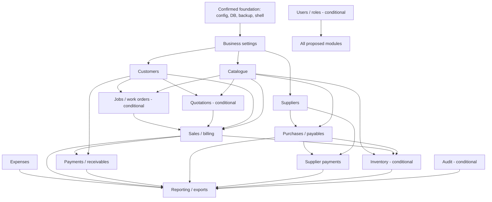

# MODULE SPECIFICATIONS — Gobindas Graphics Business Management System

| Field | Value |
| --- | --- |
| Document | MODULE_SPECIFICATIONS.md |
| Version | 1.0 |
| Date | 2026-11-18 |
| Status | Phase 6 planning output — module boundaries are proposed; no modules are implemented |
| Scope | Existing foundation modules, proposed business modules, shared services, dependencies, functional data requirements |
| Related | BUSINESS_REQUIREMENTS.md, BUSINESS_WORKFLOWS.md, BUSINESS_RULES.md, REPORTING_REQUIREMENTS.md, OPEN_DECISIONS.md |

## 0. Status labels

- **[CONFIRMED]** — exists in the current codebase or is a documented architectural constraint.
- **[PROPOSED]** — planning boundary for a future module; not approved for implementation.
- **[REQUIRES OWNER CLARIFICATION]** — module cannot be designed or sequenced reliably yet.
- **[OUT OF SCOPE]** — excluded from current product or Phase 6.

Module names correspond to eventual navigation labels where appropriate, but no placeholder is replaced by this document.

## 1. Architecture constraints

- [CONFIRMED] The application is a modular monolith using the existing layers:
  - `app/core`: cross-cutting primitives, errors, date/time, configuration contracts.
  - `app/domain`: business entities, value objects, domain rules, repository interfaces; no PySide6.
  - `app/application` or `app/services`: application services orchestrating use cases.
  - `app/infrastructure`: SQLAlchemy/Alembic, filesystem, backup, config persistence.
  - `app/ui`: PySide6 views, view models, widgets, theme, navigation.
- [CONFIRMED] UI widgets must not contain business rules.
- [CONFIRMED] Repository implementations must not decide business validity.
- [CONFIRMED] Foundation upgrades must continue to use the verified safety-backup gate.
- [CONFIRMED] Existing navigation placeholders remain honest until a module is implemented and approved.
- [PROPOSED] Business modules communicate through application services and domain events/value objects, not by importing each other's UI classes.
- [PROPOSED] Cross-module reads use read models or repository queries approved by the owning module, not direct writes to another module's tables.

## 2. Current module inventory

| Module / area | Status | Responsibility |
| --- | --- | --- |
| Core settings and errors | [CONFIRMED] | App paths, app config, exception hierarchy, diagnostics/logging. |
| Migration and database infrastructure | [CONFIRMED] | Baseline, revision checks, create/open, Alembic maintenance gate. |
| Setup and startup classification | [CONFIRMED] | `SETUP_REQUIRED`, `RECOVERY_REQUIRED`, `READY`; safe first launch. |
| Backup, restore, relocation, scheduler | [CONFIRMED] | Verified backup, staged restore, rollback, retention, location changes. |
| UI shell, theme, dashboard, backup view | [CONFIRMED] | Navigation, accessible QSS foundation, honest status cards, task feedback. |
| Business settings | [PROPOSED] | Business profile and approved document defaults. |
| Customers | [PROPOSED] | Customer master data and customer-facing balances/statements. |
| Suppliers | [PROPOSED] | Supplier master data and payable/supplier statements. |
| Catalogue | [PROPOSED] | Products/services, categories, units, price basis. |
| Jobs / work orders | [REQUIRES OWNER CLARIFICATION] | Customer work tracking if confirmed. |
| Quotations / estimates | [REQUIRES OWNER CLARIFICATION] | Pre-work estimates if confirmed. |
| Sales / billing | [PROPOSED] | Invoices and sales transactions. |
| Payments / receivables | [PROPOSED] | Customer payments and outstanding balances. |
| Purchases / payables | [PROPOSED] | Supplier bills and outstanding payables. |
| Expenses | [PROPOSED] | Non-purchase business costs. |
| Inventory | [REQUIRES OWNER CLARIFICATION] | Stock receipts, issues, adjustments, valuation if applicable. |
| Accounting | [REQUIRES OWNER CLARIFICATION] | Ledger depth and financial summaries; not statutory accounting. |
| Reporting and exports | [PROPOSED] | Operational/financial reports, print, PDF, Excel. |
| Users / roles | [REQUIRES OWNER CLARIFICATION] | Conditional auth and permissions. |
| Audit / history | [PROPOSED] | Append-only history for significant actions. |
| Attachments | [REQUIRES OWNER CLARIFICATION] | Receipts, artwork, proofs, and supporting files. |

## 3. Proposed module dependency map

The dependency map is [PROPOSED]. Modules must not create circular dependencies.

## 4. Shared functionality

### 4.1 Confirmed shared foundation

- [CONFIRMED] **Application configuration and paths**: user-selected local data root, stable folder layout, no guessed paths.
- [CONFIRMED] **Errors and diagnostics**: `AppError` hierarchy, correlation IDs, structured logs, honest error surfacing.
- [CONFIRMED] **Money primitives**: `Decimal` service-side calculations, integer paise persistence, INR formatting with Indian grouping.
- [CONFIRMED] **Date/time primitives**: date-only business dates with system-local time zone discipline; fiscal-year context available for future reports.
- [CONFIRMED] **Task runner and feedback**: asynchronous progress for long-running actions in the UI.
- [CONFIRMED] **Backup and restore services**: reusable verified data-protection operations.
- [CONFIRMED] **Theme and navigation shell**: light/dark QSS, accessible status styling, fixed sidebar, placeholder view.

### 4.2 Proposed shared services

| Shared service | Purpose | Status | Blocked by |
| --- | --- | --- | --- |
| Validation service | Common required-field, length, range, duplicate, and cross-field checks | [PROPOSED] | Field-level rules per module |
| Document numbering service | Central numbered-document allocation | [PROPOSED] | Q-10 |
| Audit service | Append-only record of significant actions | [PROPOSED] | Q-04, Q-22 |
| Attachment service | Store, validate, hash, and retrieve supporting files | [REQUIRES OWNER CLARIFICATION] | Q-18, Q-24 |
| Permission service | Role checks in application services | [REQUIRES OWNER CLARIFICATION] | Q-04 |
| Export service | PDF/Excel/print output with safe filenames | [PROPOSED] | Q-17, AQ-06 |
| Search/select service | Reusable party/item pickers | [PROPOSED] | Module field approval |
| Posting service | Controlled balance/stock effects after document posting | [PROPOSED] | Q-05, Q-06, Q-09, Q-14, Q-15 |

Shared services must not become a place for undocumented business decisions. Each rule belongs in the domain layer and must carry a rule ID from `BUSINESS_RULES.md` once approved.

## 5. Proposed business module specifications

### 5.1 Business settings

- **Status:** [PROPOSED]
- **UI surface:** Settings page, currently a placeholder.
- **Application services:** `BusinessProfileService`, approved setting maintenance.
- **Domain responsibilities:** Completeness rules for document-ready profile; fiscal/currency conventions already confirmed.
- **Data requirements:** Business name, address, contact identifiers, document footer text, tax identifiers if applicable, logo/attachment metadata if approved.
- **Relationships:** Referenced by invoices, quotations, purchase documents, and reports as document context.
- **Validation/restrictions:** Required fields and printed-document fields are not approved; no numbering or financial default may be silently stored here before approval.
- **Outputs:** Profile completion status; document header/footer data.
- **Dependencies:** Confirmation foundation; attachments and Q-03/Q-17 if tax/print fields are needed.
- **Open decisions:** Q-03, Q-17, `B6-09`.

### 5.2 Customers

- **Status:** [PROPOSED]
- **UI surface:** Customers page, currently a placeholder.
- **Application services:** `CustomerService`.
- **Domain responsibilities:** Customer identity validation, deactivation policy, approved balance/display rules.
- **Data requirements:** Display name, contact person if applicable, phone/email/address, status, notes, optional opening balance and credit fields if approved.
- **Relationships:** Linked to jobs, quotations, invoices, payments, statements, and audit events.
- **Validation/restrictions:** Duplicate identity handling, required fields, and contact rules are unapproved; historical documents need snapshot/denormalized display values once approved.
- **Outputs:** Customer list, customer detail, customer statement source data.
- **Dependencies:** Business settings for document context; permissions/audit if approved.
- **Open decisions:** `B6-13`, Q-08, Q-09, `B6-05`, `B6-11`.

### 5.3 Suppliers

- **Status:** [PROPOSED]
- **UI surface:** Suppliers page, currently a placeholder.
- **Application services:** `SupplierService`.
- **Domain responsibilities:** Supplier identity validation, deactivation policy, approved payable/display rules.
- **Data requirements:** Display name, contact person if applicable, phone/email/address, status, notes, optional payment/payable defaults if approved.
- **Relationships:** Linked to purchase bills, supplier payments, statements, and audit events.
- **Validation/restrictions:** Duplicate and required-field rules unapproved; referenced suppliers are not hard-deleted.
- **Outputs:** Supplier list, supplier detail, supplier statement source data.
- **Dependencies:** Business settings, permissions/audit if approved.
- **Open decisions:** `B6-13`, Q-09, `B6-11`.

### 5.4 Catalogue

- **Status:** [PROPOSED]
- **UI surface:** Product/service maintenance inside a future Sales or Settings area.
- **Application services:** `CatalogueService`.
- **Domain responsibilities:** Item identity, goods/service classification if approved, active/inactive lifecycle, approved price basis.
- **Data requirements:** Name, code/reference if approved, category, unit, price basis, default rate if approved, tax category if applicable, status.
- **Relationships:** Used by quotations, jobs, invoices, purchase bills, stock movements if applicable, and reports.
- **Validation/restrictions:** Exact graphics/printing service list and unit model are unresolved; do not assume hours, pages, pieces, or square feet.
- **Outputs:** Catalogue list, item lookup, sales/purchase-by-item source data.
- **Dependencies:** Q-07 and `B6-01`; tax decision Q-03; inventory decision if goods are tracked.
- **Open decisions:** Q-03, Q-05, Q-07, Q-23, `B6-01`.

### 5.5 Jobs / work orders

- **Status:** [REQUIRES OWNER CLARIFICATION]
- **UI surface:** Potential Operations area; no current navigation entry named Jobs.
- **Application services:** `JobService` if approved.
- **Domain responsibilities:** Job identity, lifecycle, due-date/status rules, link rules to quotation/invoice/delivery.
- **Data requirements:** Customer, description/specification, item/category, quantity, due date, internal status if approved, attachment metadata, related document references.
- **Relationships:** Customer, catalogue, quotations, invoices, delivery notes if approved, attachments, audit.
- **Validation/restrictions:** No approved lifecycle, required fields, or completion rule. Must not assume manufacturing or print-shop stages without owner confirmation.
- **Outputs:** Work list, job detail, job traceability.
- **Dependencies:** Customer and catalogue modules; owner decision on job tracking.
- **Open decisions:** `B6-02`, `B6-03`, `B6-04`, Q-24.

### 5.6 Quotations / estimates

- **Status:** [REQUIRES OWNER CLARIFICATION]
- **UI surface:** Potential Sales sub-page.
- **Application services:** `QuotationService` if approved.
- **Domain responsibilities:** Estimate numbering, validity, acceptance/conversion rules, pricing snapshots.
- **Data requirements:** Customer, job/scope, lines, quantities, rates, discount/tax if approved, status, validity dates if approved.
- **Relationships:** Customer, catalogue, jobs, invoices.
- **Validation/restrictions:** Provisional default is not in v1 (Q-13); do not implement without approval.
- **Outputs:** Quotation document, conversion trace.
- **Dependencies:** Customer, catalogue, possible job module; tax/discount/numbering decisions.
- **Open decisions:** Q-03, Q-08, Q-10, Q-13.

### 5.7 Sales / billing

- **Status:** [PROPOSED]
- **UI surface:** Sales page, currently a placeholder.
- **Application services:** `SalesInvoiceService`, invoice line calculation via domain rules.
- **Domain responsibilities:** Invoice identity, line math, totals, discount/tax if approved, posting state, snapshot of customer/item data.
- **Data requirements:** Customer/walk-in reference, date, number, lines, quantities, rates, discounts/tax if approved, totals, status, payment terms if approved.
- **Relationships:** Customer, catalogue, job/quotation if approved, payments, stock movements if applicable, audit.
- **Validation/restrictions:** Posted invoices cannot be silently edited/deleted; tax, discount, numbering, credit terms, and cancellations are unapproved.
- **Outputs:** Invoice document, sales register, receivables, customer statement source data.
- **Dependencies:** Customer and catalogue; profile for printing; payment/module decisions.
- **Open decisions:** Q-03, Q-08, Q-09, Q-10, Q-13, Q-14, Q-17, `B6-05`, `B6-08`, `B6-10`.

### 5.8 Payments / receivables

- **Status:** [PROPOSED]
- **UI surface:** Sales or Accounting sub-page.
- **Application services:** `CustomerPaymentService`, balance query services.
- **Domain responsibilities:** Payment identity, allocation, outstanding balance, reversal rules if approved.
- **Data requirements:** Customer, amount, date, method, reference, allocation to documents if approved, status, audit metadata.
- **Relationships:** Customer, sales invoices, audit, reports.
- **Validation/restrictions:** Allocation, overpayment, part-payment, advance, and reversal behavior need approval.
- **Outputs:** Receipts, customer statement, receivables/aging data.
- **Dependencies:** Customer and sales modules.
- **Open decisions:** Q-09, Q-14, `B6-08`.

### 5.9 Purchases / payables

- **Status:** [PROPOSED]
- **UI surface:** Purchases page, currently a placeholder.
- **Application services:** `PurchaseBillService`.
- **Domain responsibilities:** Bill identity, line math, tax if approved, payable creation, stock/expense effects if approved.
- **Data requirements:** Supplier, date, reference/number, lines, quantities, rates, tax/discount if approved, totals, status.
- **Relationships:** Supplier, catalogue, inventory if applicable, expenses if applicable, supplier payments, audit.
- **Validation/restrictions:** Purchase-order workflow, numbering, tax, returns, and stock posting are unresolved.
- **Outputs:** Purchase register, payables, supplier statement source data.
- **Dependencies:** Supplier and catalogue; tax/numbering/stock decisions.
- **Open decisions:** Q-03, Q-05, Q-06, Q-09, Q-10, Q-14, `B6-06`.

### 5.10 Supplier payments

- **Status:** [PROPOSED]
- **UI surface:** Purchases or Accounting sub-page.
- **Application services:** `SupplierPaymentService`.
- **Domain responsibilities:** Payment identity, payable allocation, reversal rules if approved.
- **Data requirements:** Supplier, amount, date, method, reference, allocations, status, audit metadata.
- **Relationships:** Supplier, purchase bills, audit, reports.
- **Validation/restrictions:** Allocation and advance/overpayment behavior unapproved.
- **Outputs:** Supplier statement, payables report, cash/bank summary.
- **Dependencies:** Supplier and purchases modules.
- **Open decisions:** Q-09, Q-14.

### 5.11 Expenses

- **Status:** [PROPOSED]
- **UI surface:** Expenses page, currently a placeholder.
- **Application services:** `ExpenseService`.
- **Domain responsibilities:** Expense identity, category rules, amount validation, posting/correction rules.
- **Data requirements:** Date, category, payee, amount, payment method, reference, notes, attachment metadata if approved, status.
- **Relationships:** Business settings, audit, reports, optional accounting read models.
- **Validation/restrictions:** Categories, tax, approval thresholds, and posting effects are unapproved.
- **Outputs:** Expense register, expense summary, profit-and-loss source data if approved.
- **Dependencies:** Attachment and accounting decisions for full functionality.
- **Open decisions:** Q-03, Q-15, Q-24, `B6-10`.

### 5.12 Inventory

- **Status:** [REQUIRES OWNER CLARIFICATION]
- **UI surface:** Inventory page, currently a placeholder.
- **Application services:** `InventoryService`, `StockMovementService` if approved.
- **Domain responsibilities:** Stock identity, movement posting, valuation, negative-stock policy, adjustment rules.
- **Data requirements:** Item, quantity, unit, movement type/source, date, valuation values if approved, status, reference document.
- **Relationships:** Catalogue, sales, purchases, returns/cancellations, reports.
- **Validation/restrictions:** No valuation method or negative-stock behavior is confirmed. Do not implement stock postings from sales/purchases without approval.
- **Outputs:** Stock ledger, stock summary, movement register, valuation report if approved.
- **Dependencies:** Owner confirmation that inventory is needed; Q-05, Q-06.
- **Open decisions:** Q-05, Q-06, Q-16, `B6-07`.

### 5.13 Accounting

- **Status:** [REQUIRES OWNER CLARIFICATION]
- **UI surface:** Accounting page, currently a placeholder.
- **Application services:** Ledger/read-model services if approved.
- **Domain responsibilities:** Chart/account mapping, posting rules, period sums, reconciliation checks.
- **Data requirements:** Accounts or categories, posting source documents, periods, balances, opening balances if approved.
- **Relationships:** Sales, purchases, payments, expenses, inventory if applicable, reporting.
- **Validation/restrictions:** Accounting depth is unresolved; no statutory accounting or tax filing is in scope.
- **Outputs:** Trial balance, profit and loss, balance summary if approved.
- **Dependencies:** Q-15 and all posting-rule decisions.
- **Open decisions:** Q-03, Q-15, Q-16.

### 5.14 Reporting and exports

- **Status:** [PROPOSED]
- **UI surface:** Reports page, currently a placeholder.
- **Application services:** `ReportQueryService`, `ExportService`, print/PDF/Excel orchestration.
- **Domain responsibilities:** Approved report definitions, filters, grouping, totals; no invented metrics.
- **Data requirements:** Read models from implemented modules, date ranges, fiscal-year context, filters, export options.
- **Relationships:** All business modules and audit if approved.
- **Validation/restrictions:** Reports dependent on unapproved rules remain blocked; export files must not overwrite silently.
- **Outputs:** Printable reports, PDF, Excel, dashboard data.
- **Dependencies:** Underlying modules and rule decisions.
- **Open decisions:** Q-15, Q-17, AQ-06, `B6-12`.

### 5.15 Users / roles

- **Status:** [REQUIRES OWNER CLARIFICATION]
- **UI surface:** Potential Settings sub-page; no implementation in Phase 6.
- **Application services:** Authentication/authorization services if approved.
- **Domain responsibilities:** Identity, roles, permissions, approval authority.
- **Data requirements:** User identity, password/credential policy if approved, roles, status.
- **Relationships:** Every business module with protected actions; audit actor model.
- **Validation/restrictions:** Q-04 is open. Local single-user operation remains the operating assumption until approval.
- **Outputs:** Permission decisions and audit actor identity.
- **Dependencies:** Secure credential storage decision and architecture review.
- **Open decisions:** Q-04, Q-18, Q-22.

### 5.16 Audit / history

- **Status:** [PROPOSED]
- **UI surface:** Record history panels or a future Admin area.
- **Application services:** `AuditService`.
- **Domain responsibilities:** Append-only event semantics, actor identity, correlation ID, event summaries.
- **Data requirements:** Entity type/id, event type, timestamp, actor if available, correlation ID, before/after summary, reason if applicable.
- **Relationships:** All posted/corrected business records.
- **Validation/restrictions:** Audit retention, redaction, and visibility are unapproved; actor identity depends on Q-04.
- **Outputs:** Record history, audit exports if approved.
- **Dependencies:** Application-service interception points; decision on actor model.
- **Open decisions:** Q-04, Q-22, `B6-11`.

### 5.17 Attachments

- **Status:** [REQUIRES OWNER CLARIFICATION]
- **UI surface:** Attachment panels on business records if approved.
- **Application services:** `AttachmentService`.
- **Domain responsibilities:** File metadata validation, link lifecycle, approved storage policy.
- **Data requirements:** File name, type, size, hash, category, related entity, storage reference, added timestamp.
- **Relationships:** Business profile, jobs, invoices, expenses, possibly suppliers/customers.
- **Validation/restrictions:** Storage location, max size, allowed types, backup inclusion, and removal rules are unapproved.
- **Outputs:** Attachment metadata and previews where safe.
- **Dependencies:** Q-24, Q-18, AQ-04.
- **Open decisions:** Q-18, Q-24.

## 6. Functional data requirements

These are functional planning requirements, not table definitions or migration instructions.

| Data area | Functional purpose | Required/expected information | Relationships | Lifecycle/deletion policy | Validation status |
| --- | --- | --- | --- | --- | --- |
| Business profile | Document identity | Name, address, contacts, document footer; tax fields if approved | Used by all printed documents/reports | Replace/history, not silent delete | [PROPOSED] fields unapproved |
| Customer | Party master | Display name, contact details, status | Jobs, quotes, invoices, payments | Active/inactive; no hard delete after use | [PROPOSED] duplicates unapproved |
| Supplier | Party master | Display name, contact details, status | Purchase bills, payments | Active/inactive; no hard delete after use | [PROPOSED] duplicates unapproved |
| Product/service | Catalogue item | Name, category, unit, price basis if approved | Jobs, quotes, invoices, purchases, stock if applicable | Active/inactive after use | [PROPOSED] Q-07 open |
| Category/unit | Classification | Name, active status | Catalogue | Active/inactive | [PROPOSED] |
| Job/work order | Customer work tracking if approved | Customer, scope, dates, status if approved | Quotes, invoices, attachments, delivery | Lifecycle unapproved | [REQUIRES OWNER CLARIFICATION] |
| Quotation | Estimate if approved | Customer, scope, lines, validity/status | Jobs, invoices | Converted/expired/rejected history | [REQUIRES OWNER CLARIFICATION] |
| Sales invoice | Posted customer sale | Customer snapshot, date, number, lines, totals, status | Payments, stock, reports, audit | Posted = no silent edit/delete | [PROPOSED] rules open |
| Invoice line | Sold item/service snapshot | Item snapshot, quantity, rate, discount/tax if approved | Invoice | Inherits invoice lifecycle | [PROPOSED] |
| Customer payment | Money received | Customer, amount, date, method, reference, allocation | Invoice/customer balance | Posted with approved reversal only | [PROPOSED] Q-09 open |
| Purchase bill | Posted supplier charge | Supplier snapshot, date, reference, lines, totals | Payments, stock, reports, audit | Posted = no silent edit/delete | [PROPOSED] rules open |
| Supplier payment | Money paid | Supplier, amount, date, method, allocation | Purchase bill/payable | Posted with approved reversal only | [PROPOSED] Q-09 open |
| Expense | Business cost | Date, category, payee, amount, method, reference | Reports/accounting read models | Posted with correction history | [PROPOSED] |
| Stock movement | Inventory effect if approved | Item, quantity, unit, source, date, valuation | Catalogue, sales, purchases | Append-only; reversals explicit | [REQUIRES OWNER CLARIFICATION] |
| Document sequence | Numbering source | Document type, period/scope if approved, next value rule | All numbered documents | Never silently reused | [REQUIRES OWNER CLARIFICATION] Q-10 |
| Attachment metadata | Supporting files | File name, type, size, hash, link, storage reference | Business records | Removal policy unapproved | [REQUIRES OWNER CLARIFICATION] Q-24 |
| Audit event | accountability/history | Entity, event, actor, timestamp, correlation ID, summary | All significant records | Append-only; retention unapproved | [PROPOSED] Q-04/Q-22 |
| User/role | Conditional access model | Identity, roles, status | All protected actions | Lifecycle unapproved | [REQUIRES OWNER CLARIFICATION] Q-04 |

## 7. Module prerequisites

| Proposed module | Minimum prerequisites owner must settle |
| --- | --- |
| Business settings | Exact profile/document fields; tax-print requirement. |
| Customers | Required fields, duplicate policy, walk-in policy, balance visibility. |
| Suppliers | Required fields, duplicate policy, balance visibility. |
| Catalogue | Service catalogue, units, price basis, goods/service distinction. |
| Jobs | Whether job tracking exists; lifecycle, statuses, due-date rules, attachment needs. |
| Quotations | Whether estimates exist; acceptance/conversion behavior. |
| Invoices | Tax model, discounts, numbering, credit policy, posted-record correction policy. |
| Payments | Part-payment, allocation, overpayment, advance, reversal rules. |
| Purchases | Supplier bill workflow, tax, numbering, return policy. |
| Expenses | Categories, approval, attachment, accounting treatment. |
| Inventory | Whether stock exists; valuation method; negative-stock and adjustment policy. |
| Accounting | Depth of ledger and reconciliation expectations. |
| Reports | Approved source modules and metric definitions. |
| Users/roles | Whether login/roles are required and who may approve actions. |
| Audit | Actor identity, event list, retention, visibility. |
| Attachments | Storage location, size/type limits, backup inclusion, deletion policy. |

## 8. Recommended implementation order

[PROPOSED] after owner review:

1. Business settings and party masters.
2. Catalogue.
3. Confirmed job/quotation workflow, if approved.
4. Sales invoices and customer payments.
5. Purchases and supplier payments.
6. Expenses.
7. Inventory only if confirmed.
8. Accounting/read models and reports.
9. Audit visibility, attachments, and users/roles if approved.

This sequence minimizes rework because document posting, numbering, tax, and valuation decisions are resolved before financial modules depend on them. It is not a commitment to implement all listed modules.
